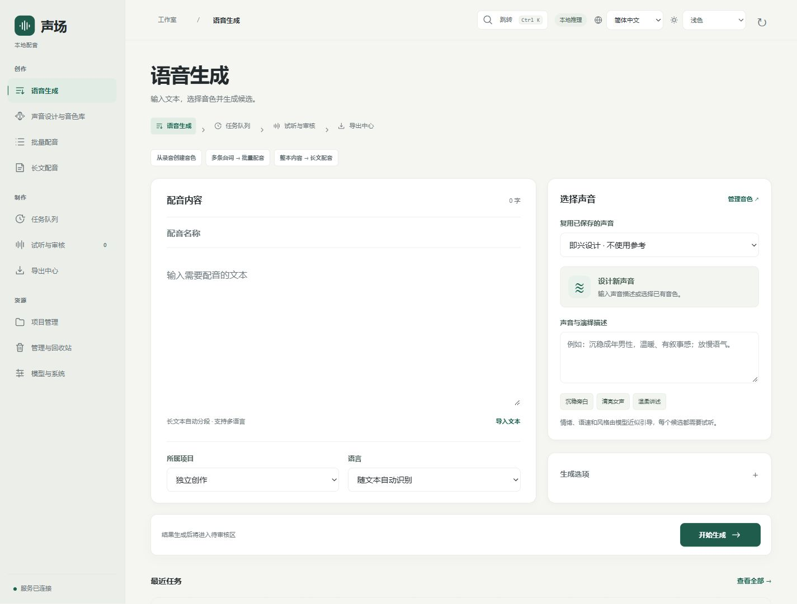

**简体中文** | [English](README.en.md) | [日本語](README.ja.md) | [한국어](README.ko.md)

# 声场 · Voice Foundry

在 Windows 本机设计声音、克隆音色，为台词、视频或整本书配音。WebUI、CLI、REST API 和 MCP 共用模型与音色库，不需要按项目重复安装。

目前接入 VoxCPM2。界面支持中英日韩四种语言和深浅配色，可跟随浏览器设置。界面语言与配音语言分别选择，正文、资产名称和转写保留原文。平台可独立运行，适用于游戏、影视、有声读物及交互应用。

## 界面与操作

空白安装界面，未使用用户文件。查看[操作说明](docs/WEBUI.md)、[深色界面](docs/images/studio-dark-en.jpg)和[窄屏布局](docs/images/reference-mobile-en.jpg)。

左侧按「创作、制作、资源」分组。生成时先填文本、选声音，再提交；候选数、参考克隆等选项按需展开。审核后可在同一页直接导出。右上角切换语言和配色，Ctrl / ⌘ + K 快速跳转工作区。

## 安装

完整配音需要 Windows 11、Git、[uv](https://docs.astral.sh/uv/getting-started/installation/) 和可用的 NVIDIA 驱动，主要在 RTX 4090 上验证。录音上传和处理还需要 [FFmpeg](https://ffmpeg.org/download.html)。无需预装 Python 或 Codex。

在 GitHub 选择 **Code → Download ZIP** 并全部解压，进入含 `install-voice.cmd` 的文件夹后双击它；也可在该目录运行：

~~~powershell
powershell -NoProfile -ExecutionPolicy Bypass -File .\scripts\install.ps1
~~~

完整安装会下载独立环境、固定版源码和模型，运行检查后启动服务，建议预留至少 30 GiB。只想检查界面时，在命令后添加 `-CoreOnly -NoStart`，不下载 CUDA 和模型，也不能配音。

打开 [WebUI](http://127.0.0.1:8961/)。首次使用可直接描述声音生成一句文本，不需要已有音色或录音。以后用 `start-voice.cmd` 和 `stop-voice.cmd`。下载、依赖、端口冲突与故障检查见[安装说明](docs/INSTALL.md)。

源码包不含模型权重、录音、数据库或预装环境。

## 生成与审核

1. 打开“语音生成”，输入文本。没有音色时，先用文字描述声音。
2. 生成后试听；需要比较时，为同一文本生成多个候选。
3. 试听满意后批准，在试听页选择格式并导出。

生成结果默认待审核。平台不会自动批准音频。

## 音色与参考录音

“快速创建参考”支持上传录音、自动处理、切分和推荐片段，试听后保存到音色库。原始录音会保留，支持处理前后对比。转写自动生成，使用极致克隆前需要校对。

同一人物可以保存多个参考片段，设置主参考和不同场景的参考。生成时使用其中一个片段，不会直接拼接成长录音。音色有全局 Voice ID，可跨项目复用，也可设为项目专属。

可控克隆使用参考音色和风格描述；极致克隆（Hi-Fi）使用参考录音和准确转写。情绪、语气和语速的自然语言控制是近似引导，需要试听确认。去音乐、降噪和双路人声分离可能留下失真、残留或串音。

## 长文配音

支持 TXT、Markdown 和 UTF-8、UTF-16、GB2312、GBK、GB18030 编码。导入时识别章节并分段；没有标题或换行的文本也会自动拆分。

支持暂停续作、失败段重试、逐章试听审核，以及按章节或整本导出。内容分页读取。超长文本的导入和索引验证不代表已完成整本音频生成；生成耗时取决于文本长度、模型和硬件。详见 [长文说明](docs/LONGFORM.md)。

## CLI 与 API

~~~powershell
bin\voice.cmd start
bin\voice.cmd generate --text "这是一段试听文本。" --style "沉稳成年男性，温暖自然" --wait
bin\voice.cmd voices
bin\voice.cmd health
~~~

[全局命令与 MCP](docs/INSTALL.md#全局命令与-mcp)为可选配置。WebUI 不依赖 Codex，API 不依赖浏览器。启动服务后可查看 [OpenAPI 文档](http://127.0.0.1:8961/docs)。

## 使用说明

[长文配音](docs/LONGFORM.md) · [参考音频](docs/REFERENCE_PREPROCESSING.md) · [音频处理](docs/AUDIO_RESTORATION.md) · [维护说明](docs/MAINTENANCE.md)

## 文件与维护

模型保存在 `models/`，资产和数据库在 `data/`，缓存与日志在 `runtime/`。路径统一在 `config/platform.json` 配置。导出另存文件，后处理不覆盖原始音频。

已结束任务默认 7 天后归档，也可手动批量归档。管理页删除的内容进入可恢复的回收站，不会立即释放磁盘空间。备份与恢复见 [维护说明](docs/MAINTENANCE.md)。

- [API](docs/API.md) · [架构](docs/ARCHITECTURE.md) · [模块导航](docs/MODULES.md)
- [界面语言](docs/LOCALIZATION.md)
- [测试与验证范围](docs/TESTING.md) · [源码发布](docs/PUBLISHING.md)

## 许可

平台自己的代码和文档采用 [Apache-2.0](LICENSE)。模型和依赖保留各自的许可，见 [第三方声明](THIRD_PARTY_NOTICES.md)和 [许可资料](LICENSES/README.md)。本项目不是 VoxCPM 或其他上游项目的官方产品。

请使用有权使用的录音和文本。模型开源不代表已获得某个人的声音授权，也不代表可以公开分发导入的书稿、录音或克隆结果。

[参考整理与配音流程](docs/WORKFLOW_GUIDE.md)
