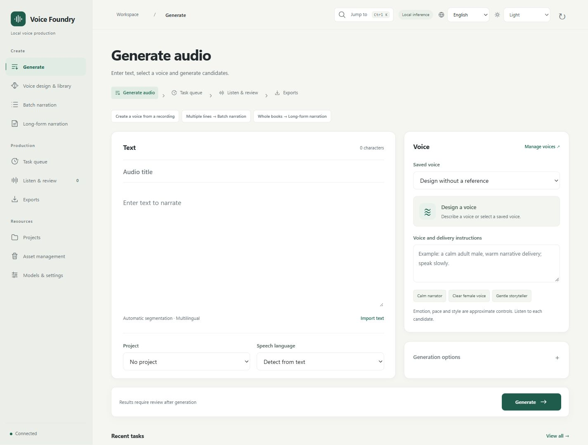
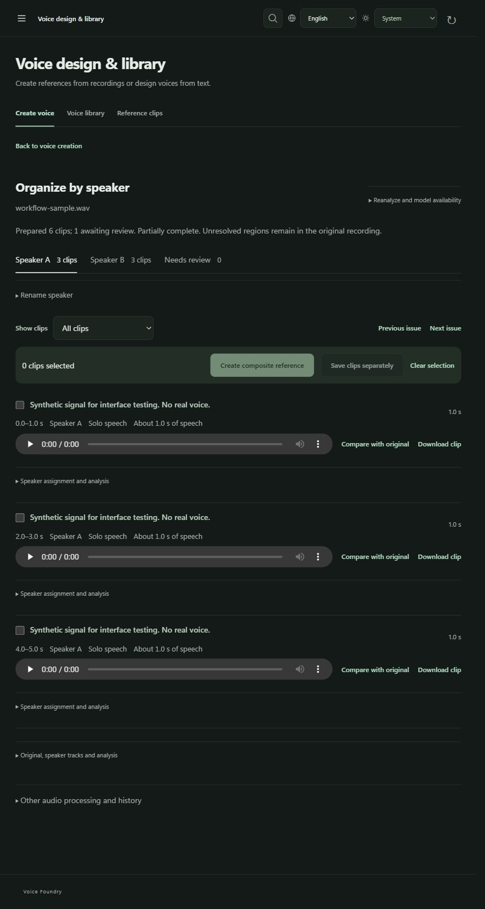
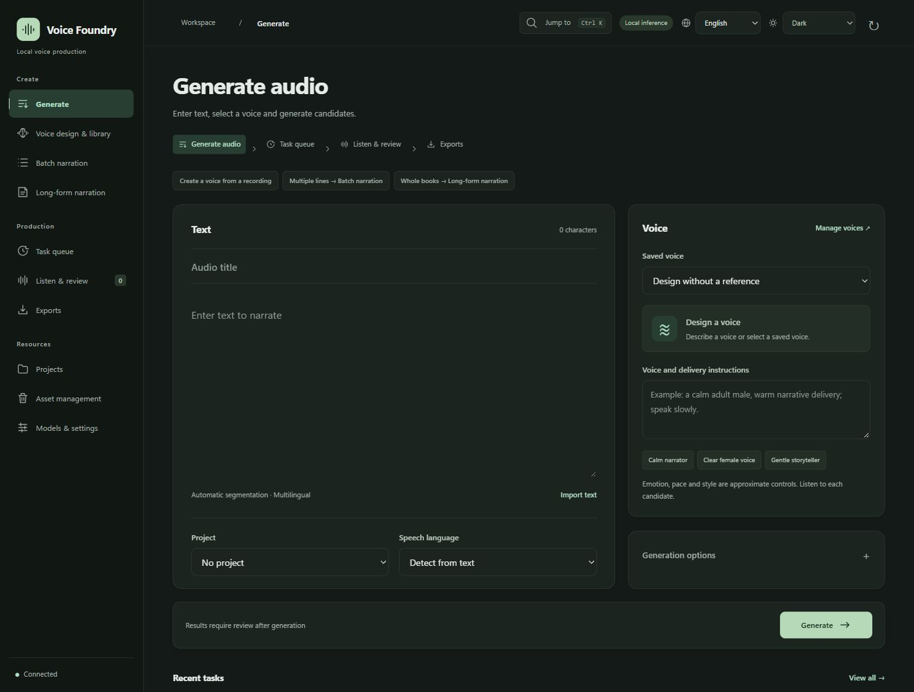
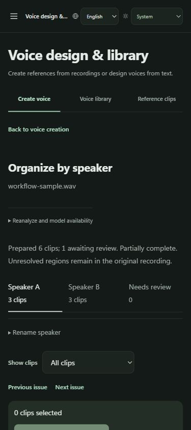

[简体中文](WEBUI.md) | **English** | [日本語](WEBUI.ja.md) | [한국어](WEBUI.ko.md)

# WebUI guide

[Back to README](../README.en.md) · [Installation](INSTALL.en.md)

Screenshots use an empty installation or synthetic test data. They contain no user files or real recordings.

The interface language applies to system defaults, processing progress and validation messages. Filenames, voice names, scripts, transcripts and custom authorization records remain in their original language.

## Find a workspace

| Navigation group | Workspaces |
| --- | --- |
| Create | Generate, Voice design & library, Batch narration, Long-form narration |
| Production | Task queue, Listen & review, Exports |
| Resources | Projects, Asset management, Models & settings |

On narrow screens, open the top-left menu for the full navigation. The voice workspace keeps three main entries.

## Generate a line

1. In Generate, enter text. Title, project and speech language are optional.
2. Choose a saved voice or describe a voice and its delivery. You can design a voice without a recording.
3. Expand Generation options for candidate count or a fixed seed. When references exist, Reference & cloning lets you select a clip and mode. Hi-Fi needs an accurate, corrected transcript and does not use extra delivery instructions.
4. Select Generate. Follow progress in Task queue, then open Listen & review.

Pace, emotion and style are approximate controls. A successful generation still needs review.

## Listen, approve and export

Play a candidate and choose Approve after listening. Confirm that you have listened and add an optional note. You can approve and keep comparing, or choose Approve and prepare export.

Select audio to show its comparison, review and export actions. Once every selected item is approved, choose a format and Export selected approved audio. The download link appears on the same page. Advanced export settings provides sample rate, channels, naming and draft packages. Drafts carry a DRAFT label and do not change review status.

Continuous comparison plays every selected item, including selections on other pages or hidden by a filter. You can stop playback at any time. To revise a candidate, choose Adjust reference and regenerate, then select a reference, cloning mode and delivery instructions. The new candidate needs its own listening review; the original audio and review record are kept.

## Create and reuse voices

The voice workspace has three entries: Create voice, Voice library and Reference clips.

- Create voice: upload recordings to organize speakers and clips, or design a voice with text. Saved recordings can be processed without uploading again.
- Voice library: listen, edit and reuse voices; manage default and scene references.
- Reference clips: search, name and annotate clips, then set up a voice and start narration.

Candidates use one checkbox selection. After saving, create a voice, add to an existing voice, or keep clips only. Choose the default when creating a voice. Composite references require explicit same-speaker selection, checks and listening confirmation. Listening assemblies never become clone references automatically. See the [reference and narration workflow](WORKFLOW_GUIDE.en.md).

## Batch and long-form work

Use Batch narration for separate lines, one per row. Check the voice and text preview before submitting. Use Long-form narration for a whole file. Existing works appear first; expand the import section to add one. Check chapters and segments, try one chapter, then continue the book. Pause generation when you need to stop computation; reopen the same work to resume.

Listen, review and export chapters inside the work. Chapter reviews are separate from the regular candidate list. See [long-form narration](LONGFORM.en.md).

Pause the work, then choose Adjust reference and regenerate beside a segment. Preview a scene reference or library clip and regenerate only that segment. Hi-Fi follows the reference delivery and needs an accurate transcript; controllable cloning accepts additional delivery instructions as approximate controls. Version history and comparison keeps successful earlier takes available for listening and adoption. Regenerating or adopting a take returns the chapter to pending review. Listen and approve it again before formal export.

## Appearance, shortcuts and management

The top-right controls select interface language and theme. System follows browser or OS preferences. Interface language does not change speech language. Changing language reloads the page and keeps text drafts; reselect files and listening confirmations.

| Action | Shortcut |
| --- | --- |
| Search and switch workspaces | Ctrl / ⌘ + K |
| Submit on Generate | Ctrl / ⌘ + Enter |
| Switch voice workspace tabs | Left/Right arrows, Home, End |
| Close workspace search or navigation | Esc |

Archive finished tasks manually or through the automatic archive setting. Deleted items can be restored from the recycle bin. Archiving and deletion do not immediately remove original files. Expand model details or installation/runtime details in Models & settings when needed. See [maintenance](MAINTENANCE.en.md) for backups and stopping the service.

Dark theme and narrow layout

## Reference and narration workflow

[Reference and narration workflow](WORKFLOW_GUIDE.en.md)
