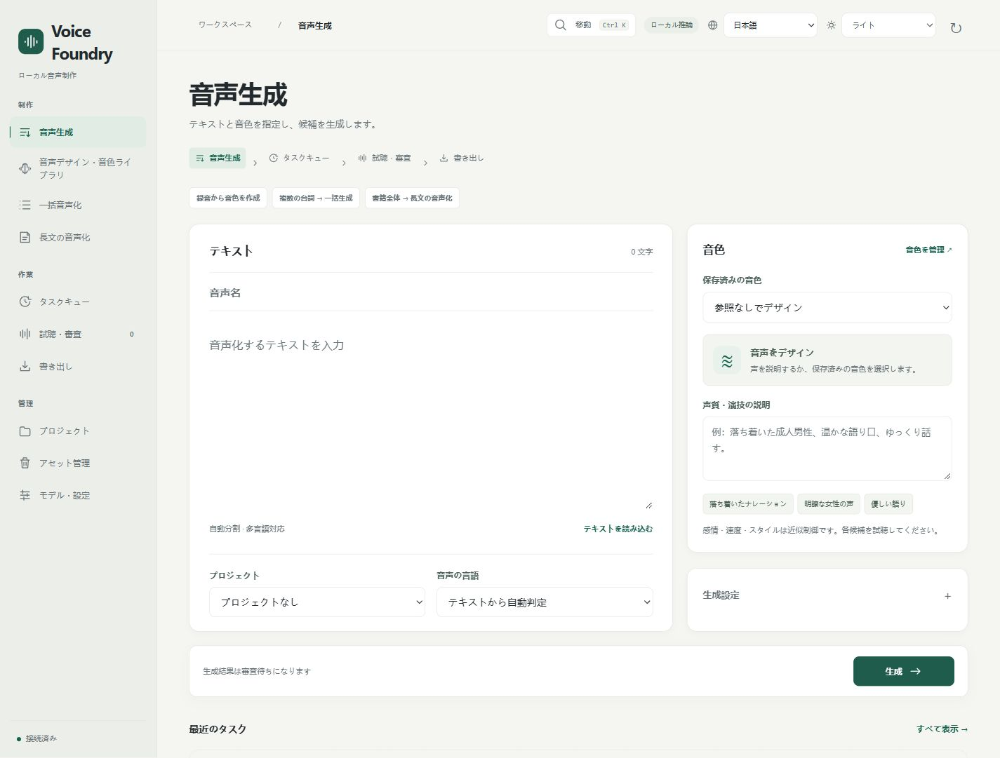

[简体中文](WEBUI.md) | [English](WEBUI.en.md) | **日本語** | [한국어](WEBUI.ko.md)

# WebUI の操作

[README に戻る](../README.ja.md) · [インストール](INSTALL.ja.md)

スクリーンショットは独立した空のデータ保存先で撮影しています。ユーザーのファイル、録音、音色、タスクは含みません。

## 機能を探す

| ナビゲーション | 機能 |
| --- | --- |
| 制作 | 音声生成、音声デザイン・音色ライブラリ、一括音声化、長文の音声化 |
| 作業 | タスクキュー、試聴・審査、書き出し |
| 管理 | プロジェクト、アセット管理、モデル・設定 |

狭い画面では左上のメニューから一覧を開きます。音色ワークスペースの四つのタブは横にスクロールできます。

## 一文を音声にする

1. 「音声生成」にテキストを入力します。音声名、プロジェクト、音声の言語は必要に応じて指定します。
2. 保存済みの音色を選ぶか、声質と演技を説明します。録音がなくても音声デザインを使えます。
3. 候補数やシードは「生成設定」を開いて指定します。参照がある場合は「参照とクローン」で区間とモードを選べます。Hi-Fi は正確に校正した書き起こしが必要で、追加の演技指示は使いません。
4. 「生成」を押し、タスクキューで進行を確認してから「試聴・審査」を開きます。

速度、感情、スタイルは近似制御です。生成完了だけでは審査済みになりません。

## 試聴して書き出す

候補を再生し、試聴後の承認を選びます。聴いたことを確認し、必要ならメモを記入します。承認後も比較を続けるか、承認と書き出し準備をまとめて行えます。

音声を選択すると比較、審査、書き出し操作が表示されます。選択項目がすべて承認済みなら形式を選び、その場で書き出せます。ダウンロードリンクも同じ画面に表示されます。サンプルレート、チャンネル、命名、下書き出力は詳細な書き出し設定を開きます。下書きには DRAFT が付き、審査状態は変わりません。

## 音色を作って再利用する

「音声デザイン・音色ライブラリ」でタブを選びます。

- 「参照を作成」：利用許可のある録音をアップロードし、推薦区間を試聴して人物の音色を保存します。
- 「音色ライブラリ」：保存した音色を検索、試聴、編集します。生成開始の操作で音色を生成画面に引き継げます。
- 「音声デザイン」：声を説明してサンプルを生成し、参照準備に送ります。
- 「音声処理」：音楽除去、重なった二人の声の分離、ノイズ低減を選び、処理前後を比べて参照を決めます。

元の録音は保持します。一人に複数の参照を保存できますが、生成時は一つずつ使い、長い録音につなぎません。[参照音声](REFERENCE_PREPROCESSING.ja.md)と[音声処理](AUDIO_RESTORATION.ja.md)を参照してください。

## 一括生成と長文

個別の台詞には「一括音声化」を使い、一行に一つ入力します。送信前に音色と本文のプレビューを確認します。ファイル全体には「長文の音声化」を使います。既存作品が先に表示され、新規読み込み欄は展開できます。章と区間を確認し、一章を試してから全編を続けます。計算を止めるときは生成を一時停止し、同じ作品を開いて再開します。

章の試聴、審査、書き出しは作品内で行います。章の審査と通常の候補一覧は別管理です。詳しくは[長文の音声化](LONGFORM.ja.md)を参照してください。

## 外観・ショートカット・管理

右上で表示言語と配色を選びます。「システムに従う」はブラウザーまたは OS の設定を使います。表示言語を変えても音声の言語は変わりません。言語切り替えではページを再読み込みし、テキスト下書きを保持します。ファイルと試聴確認は選び直してください。

| 操作 | キー |
| --- | --- |
| ワークスペースを検索して移動 | Ctrl / ⌘ + K |
| 音声生成画面で送信 | Ctrl / ⌘ + Enter |
| 音色ワークスペースのタブ切り替え | 左右矢印、Home、End |
| 検索やナビゲーションを閉じる | Esc |

終了したタスクは手動または設定した期間でアーカイブできます。削除した項目はごみ箱から復元できます。どちらも元ファイルを直ちに消去しません。「モデル・設定」では対応言語、モデルのバージョン、保存先と実行環境を必要なときだけ開けます。バックアップとサービス停止は[保守手順](MAINTENANCE.ja.md)を参照してください。

ダーク配色と狭い画面・英語表示

