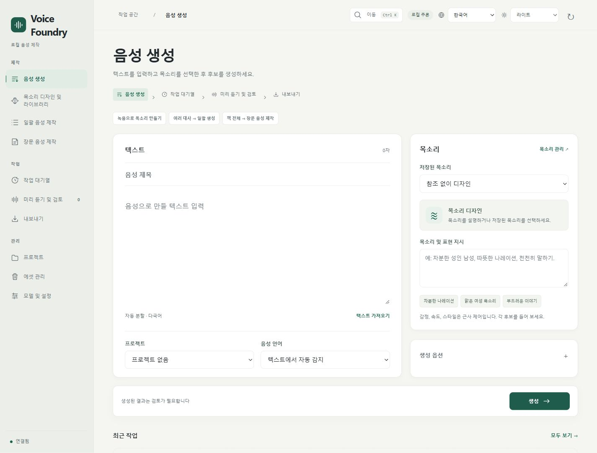

[简体中文](WEBUI.md) | [English](WEBUI.en.md) | [日本語](WEBUI.ja.md) | **한국어**

# WebUI 사용법

[README로 돌아가기](../README.ko.md) · [설치](INSTALL.ko.md)

스크린샷은 별도의 빈 데이터 폴더에서 촬영했습니다. 사용자 파일, 녹음, 목소리, 작업 기록은 포함하지 않습니다.

## 기능 찾기

| 탐색 그룹 | 기능 |
| --- | --- |
| 제작 | 음성 생성, 목소리 디자인 및 라이브러리, 일괄 음성 제작, 장문 음성 제작 |
| 작업 | 작업 대기열, 미리 듣기 및 검토, 내보내기 |
| 관리 | 프로젝트, 에셋 관리, 모델 및 설정 |

좁은 화면에서는 왼쪽 위 메뉴로 전체 목록을 엽니다. 목소리 작업 공간의 네 탭은 가로로 스크롤할 수 있습니다.

## 한 문장 생성하기

1. ‘음성 생성’에 텍스트를 입력합니다. 제목, 프로젝트, 음성 언어는 필요할 때 지정합니다.
2. 저장된 목소리를 선택하거나 목소리와 표현을 설명합니다. 녹음 없이도 목소리를 디자인할 수 있습니다.
3. 후보 수나 시드는 ‘생성 옵션’을 펼쳐 지정합니다. 참조가 있으면 ‘참조 및 복제’에서 구간과 모드를 고릅니다. Hi-Fi에는 교정한 정확한 전사가 필요하며 추가 표현 지시는 사용하지 않습니다.
4. ‘생성’을 누르고 작업 대기열에서 진행 상황을 확인한 뒤 ‘미리 듣기 및 검토’를 엽니다.

속도, 감정, 스타일은 근사 제어입니다. 생성 완료만으로 검토가 끝나지는 않습니다.

## 듣고 승인한 뒤 내보내기

후보를 재생하고 듣기 후 승인을 선택합니다. 실제로 들었는지 확인하고 필요하면 메모를 적습니다. 승인 후 비교를 계속하거나 승인과 내보내기 준비를 함께 진행할 수 있습니다.

오디오를 선택하면 비교, 검토, 내보내기 작업이 표시됩니다. 선택한 항목이 모두 승인되면 형식을 고르고 같은 화면에서 내보냅니다. 다운로드 링크도 그 자리에 나타납니다. 샘플레이트, 채널, 파일 이름, 초안 패키지는 고급 내보내기 설정에서 지정합니다. 초안에는 DRAFT가 표시되며 검토 상태는 바뀌지 않습니다.

## 목소리 만들고 재사용하기

‘목소리 디자인 및 라이브러리’에서 탭을 고릅니다.

- ‘참조 클립’: 개별 클립에 이름과 장면을 지정하고 인물에 한꺼번에 추가합니다.
- ‘빠른 참조 만들기’: 사용 권한이 있는 녹음을 올리고 추천 구간을 들어 본 뒤 인물 목소리를 저장합니다.
- ‘목소리 라이브러리’: 저장된 목소리를 찾고 듣고 편집합니다. 음성 제작 시작을 선택하면 생성 화면으로 전달됩니다.
- ‘목소리 디자인’: 설명으로 샘플을 생성해 참조 준비 과정으로 보냅니다.
- ‘오디오 처리’: 음악 제거, 겹친 두 목소리 분리, 잡음 감소를 선택하고 처리 전후를 비교합니다.

원본 녹음은 유지합니다. 한 인물에 여러 참조를 저장할 수 있지만 생성할 때는 하나씩 사용하며 긴 녹음으로 합치지 않습니다. [참조 오디오](REFERENCE_PREPROCESSING.ko.md)와 [오디오 처리](AUDIO_RESTORATION.ko.md)를 참고하세요.

## 일괄 작업과 장문

개별 대사는 ‘일괄 음성 제작’에서 한 줄에 하나씩 입력합니다. 제출 전에 목소리와 텍스트 미리 보기를 확인하세요. 파일 전체는 ‘장문 음성 제작’을 사용합니다. 기존 작품이 먼저 나오며 새 가져오기 영역은 펼쳐서 엽니다. 장과 구간을 확인하고 한 장을 시험한 뒤 전체를 이어 만듭니다. 계산을 멈추려면 생성을 일시 중지하고 같은 작품을 열어 재개하세요.

장별 듣기, 검토, 내보내기는 작품 안에서 진행합니다. 장 검토와 일반 후보 목록은 별도로 관리합니다. 자세한 내용은 [장문 음성 제작](LONGFORM.ko.md)을 참고하세요.

## 테마·단축키·관리

오른쪽 위에서 표시 언어와 테마를 선택합니다. ‘시스템 설정’은 브라우저 또는 OS 설정을 따릅니다. 표시 언어는 음성 언어를 바꾸지 않습니다. 언어를 바꾸면 페이지를 새로 읽고 텍스트 초안은 유지합니다. 파일과 듣기 확인은 다시 선택하세요.

| 작업 | 단축키 |
| --- | --- |
| 작업 공간 검색 및 이동 | Ctrl / ⌘ + K |
| 음성 생성 화면에서 제출 | Ctrl / ⌘ + Enter |
| 목소리 작업 공간 탭 전환 | 좌우 화살표, Home, End |
| 검색 또는 탐색 메뉴 닫기 | Esc |

종료된 작업은 직접 보관하거나 자동 보관 기간을 설정할 수 있습니다. 삭제한 항목은 휴지통에서 복원할 수 있습니다. 보관과 삭제 모두 원본 파일을 즉시 지우지 않습니다. ‘모델 및 설정’에서 지원 언어, 모델 버전, 저장 경로와 실행 환경을 필요할 때 펼쳐 보세요. 백업과 서비스 종료는 [유지 관리](MAINTENANCE.ko.md)를 참고하세요.

어두운 테마와 좁은 화면·영어 표시

